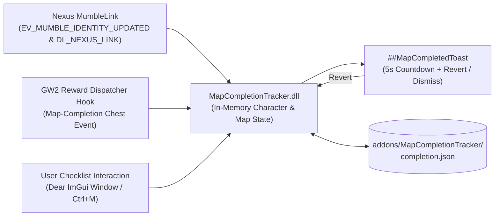

<p align="center">
  <a href="https://ko-fi.com/todd0042">
    
  </a>
</p>

---

# 🗺️ GW2 Map Completion Tracker

[](https://github.com/Todd0042/gw2-mapcompletion/releases)
[](LICENSE)
[](MapCompletionTracker.dll)
[](https://raidcore.gg/gw2/nexus)
[]()
[](https://ko-fi.com/todd0042)

> **A [Raidcore Nexus](https://raidcore.gg/gw2/nexus) addon for Guild Wars 2 that tracks per-character map completion across every expansion and Living World season—combining a searchable manual checklist with real-time reward-dispatcher auto-detection.**

---

## 📖 Table of Contents

* **Part 1 — User Overview & Quick Start**
  * [🧭 What Is GW2 Map Completion Tracker?](#-what-is-gw2-map-completion-tracker)
  * [✨ Key Features at a Glance](#-key-features-at-a-glance)
  * [⚙️ How It Works](#-how-it-works)
  * [🚀 Quick Start & Installation](#-quick-start--installation)
* **Part 2 — Technical Architecture & Reference**
  * [1. Distribution Architecture & Binary Artifact (MapCompletionTracker.dll)](#1-distribution-architecture--binary-artifact-mapcompletiontrackerdll)
  * [2. Nexus Integration, Keybinds, Events & UI Controls](#2-nexus-integration-keybinds-events--ui-controls)
  * [3. Auto-Detection Hook & MumbleLink Data Flow](#3-auto-detection-hook--mumblelink-data-flow)
  * [4. Persistent Storage & Configuration (`completion.json`)](#4-persistent-storage--configuration-completionjson)
  * [5. Tracked Expansions, Regions & Maps](#5-tracked-expansions-regions--maps)
  * [6. Repository Structure & Release Verification](#6-repository-structure--release-verification)
  * [7. License, AI Notice & Support (LICENSE)](#7-license-ai-notice--support-license)

---

# Part 1 — User Overview & Quick Start

## 🧭 What Is GW2 Map Completion Tracker?

**GW2 Map Completion Tracker** is a native Windows x86-64 plugin for the **[Raidcore Nexus](https://raidcore.gg/gw2/nexus)** addon loader in *Guild Wars 2*. Instead of juggling spreadsheets or swapping characters to remember which zones a given alt has already finished, the addon maintains a persistent per-character checklist right inside the game overlay.

Every explorable map is organized by expansion and region—from **Core Tyria** all the way through **Visions of Eternity**—with live character detection, instant filtering/sorting, clipboard progress sharing, and automatic completion detection when a map-completion chest arrives from the server.

---

## ✨ Key Features at a Glance

* **⚡ Built-In Auto-Detection**: Hooks Guild Wars 2's reward dispatcher directly to mark the active character's current map complete the moment the map-completion chest is delivered—regardless of character level.
* **🍞 5-Second Revertable Toast (`##MapCompletedToast`)**: Displays a non-intrusive bottom-right notification (`MAP COMPLETED!`) showing the character name and Map ID, complete with **Revert** and **Dismiss** buttons and a 5-second auto-dismiss countdown.
* **👤 Automatic Character Discovery**: Uses the standard Nexus MumbleLink identity event (`EV_MUMBLE_IDENTITY_UPDATED`) to detect characters automatically—log in to each character at least once to add them to the character selector dropdown.
* **🗺️ Full Expansion & Region Coverage**: Covers Core Tyria, Living World Seasons 1–4, Heart of Thorns, Path of Fire, The Icebrood Saga, End of Dragons, Secrets of the Obscure, Janthir Wilds, and Visions of Eternity.
* **🔍 Search, Filter & Sort**: Quickly narrow down zones with live text search (`Search maps...`), completion status filters (`All`, `Completed`, `Incomplete`), and flexible sorting (`Default`, `Name`, `Map ID`, `Status`).
* **📊 Multi-Level Progress Rollups**: Displays an overall completion bar (`X / Y`, percentage), completed region counts, completed expansion counts, and individual expansion tile progress (`##exptile`).
* **📍 Current-Map Jumping & Clipboard Export**: Jump straight to your active character's current zone with **Go to current**, or export a formatted summary (`GW2 Map Completion <Character>: X / Y (Z%)`) with **Copy progress**.
* **💾 Zero-Cloud Local Persistence**: Saves all character and map completion records locally to `addons/MapCompletionTracker/completion.json`.

---

## ⚙️ How It Works

The addon operates through two complementary tracking paths inside the in-game Nexus overlay:

1. **Manual Checklist Tracker**:
   * Open the tracker window with **Ctrl+M** (or your custom `KB_MAPCOMPLETION_TOGGLE` keybind / Nexus Quick Access shortcut `QA_MAPCOMPLETION`).
   * Pick any tracked character from the **Character** dropdown (`##charselect`), browse expansion tiles and region groupings, and toggle individual maps complete or incomplete at any time.
   * Use the search bar, status filter, and sort selector to focus on remaining zones.
2. **Real-Time Auto-Detect**:
   * While the addon is installed and active, it hooks GW2's reward dispatcher directly to watch for map-completion chest deliveries from the server.
   * The instant a map-completion chest is awarded, the current map is automatically marked complete for the active character and persisted to `completion.json`.
   * A bottom-right toast notification (`Auto-marked complete. Dismissing in %us.`) appears for 5 seconds with an immediate **Revert** option in case you want to undo the mark.

---

## 🚀 Quick Start & Installation

### Prerequisites
* **Guild Wars 2** (64-bit Windows client)
* **[Raidcore Nexus](https://raidcore.gg/gw2/nexus)** installed and active

### Installation Steps
1. Download [`MapCompletionTracker.dll`](MapCompletionTracker.dll) from this repository or the [GitHub Releases](https://github.com/Todd0042/gw2-mapcompletion/releases) page.
2. Place the DLL directly in your Guild Wars 2 `addons` folder:
   ```text
   <GW2 install>\addons\MapCompletionTracker.dll
   ```
   > **Important:** Do **not** place `MapCompletionTracker.dll` inside a subfolder—Raidcore Nexus does not recurse into subdirectories when scanning for addon DLLs.
3. Launch Guild Wars 2 and open the **Nexus Addon Manager**, then enable **Map Completion Tracker**.
4. Log in to each character you want to track at least once so Nexus's MumbleLink identity broadcast adds them to the character dropdown.
5. Press **Ctrl+M** in-game (or use the Nexus Quick Access button) to open the tracker overlay.

### Updating
Replace `<GW2 install>\addons\MapCompletionTracker.dll` with the newer release DLL. Your existing completion history in `addons\MapCompletionTracker\completion.json` is preserved across updates.

---
---

# Part 2 — Technical Architecture & Reference

> *This repository (`gw2-mapcompletion`) serves as the public **distribution-only** release repository for `v1.5.0+` (`v1.5.2` current). Per the `v1.5.0` release transition, source files and build scripts are maintained separately in the private `-src` repository, and only the verified compiled Windows DLL, documentation, and license are published here.*

---

## 1. Distribution Architecture & Binary Artifact ([MapCompletionTracker.dll](MapCompletionTracker.dll))

The distributed binary [`MapCompletionTracker.dll`](MapCompletionTracker.dll) is a compiled **64-bit Windows PE32+ DLL** (`x86-64`, C++ / MinGW-w64) designed to be loaded in-process by the Raidcore Nexus addon host.

| Property | Verified Value |
| :--- | :--- |
| **Artifact Path** | [`MapCompletionTracker.dll`](MapCompletionTracker.dll) |
| **Release Version** | `1.5.2` (Git tag `v1.5.2`) |
| **Binary Format** | `PE32+ executable for MS Windows 5.02 (DLL), x86-64 (stripped to external PDB), 12 sections` |
| **File Size** | `1,901,056` bytes (~1.81 MiB) |
| **SHA-256 Checksum** | `64a4247ceabe0c24e01c9790ed9d521aa322f9c59d3f5ffb4491daf87cf860a0` |
| **Exported Entry Point** | `GetAddonDef` (standard Raidcore Nexus addon descriptor export) |
| **Embedded UI & JSON Stack** | Dear ImGui (dockable/overlay rendering) + `nlohmann::json` (state serialization) |
| **Windows System Imports** | `KERNEL32.dll`, `USER32.dll`, and Windows Universal CRT (`api-ms-win-crt-*.dll`) |
| **Addon Metadata** | Name: `Map Completion Tracker` · Author: `Todd0042` |

Because this repository is distribution-only as of `v1.5.0`, there are no build scripts or C++ headers to compile locally in this tree; end users and Nexus deploy [`MapCompletionTracker.dll`](MapCompletionTracker.dll) directly.

---

## 2. Nexus Integration, Keybinds, Events & UI Controls

Inspection of [`MapCompletionTracker.dll`](MapCompletionTracker.dll) confirms the following Nexus registrations, event subscriptions, and interactive ImGui controls:

### Nexus Registrations
| Identifier | Type | Purpose |
| :--- | :--- | :--- |
| `GetAddonDef` | DLL Export | Exposes addon metadata, author (`Todd0042`), repository URL (`https://github.com/Todd0042/gw2-mapcompletion`), and Nexus lifecycle callbacks. |
| `KB_MAPCOMPLETION_TOGGLE` | Keybind | Toggles the Map Completion Tracker window (default **Ctrl+M**; customizable in Nexus keybind settings). |
| `QA_MAPCOMPLETION` | Quick Access | Registers the Nexus Quick Access bar icon (`ICON_MAPCOMPLETION` / `ICON_MAPCOMPLETION_HOVER`). |
| `EV_MUMBLE_IDENTITY_UPDATED` | Event Subscription | Receives Nexus MumbleLink character identity updates whenever the player logs in or swaps characters. |
| `DL_NEXUS_LINK` | Nexus Data Link | Reads live game/map context from Nexus shared data links (including current Map ID). |

### In-Game Overlay Controls
* **Character Selector (`##charselect`)**: Dropdown listing all characters recorded under `known_characters` and `characters`, tagging the active session character with `[current]`. Displays `"Log in to a character to start tracking."` when no character is active.
* **Navigation & Export Actions**:
  * **Go to current**: Focuses/scrolls directly to the map matching the character's current location (`Currently on: %s`).
  * **Copy progress**: Copies a summary line (`GW2 Map Completion %s: %zu / %zu (%.1f%%)`) to the system clipboard.
* **Search, Filter & Sort Toolbar**:
  * **Search (`##search`)**: Case-insensitive text filter (`Search maps...`) with a **Clear** button.
  * **Filter (`##filter`)**: `All`, `Completed`, `Incomplete`.
  * **Sort (`##sort`)**: `Default`, `Name`, `Map ID`, `Status`.
* **Progress Summary & Map List (`##mapslist`)**:
  * Overall progress bar (`MAP COMPLETION`, `%zu / %zu     %.1f %%`), plus `%zu / %zu regions complete` and `%zu / %zu expansions complete`.
  * Expansion summary tiles (`##exptile`) and grouped map rows (`##row`) showing `[COMPLETE]` / `[incomplete]` states and `[current]` indicator.
* **Auto-Mark Toast (`##MapCompletedToast`)**:
  * Displays `MAP COMPLETED!`, `Character: %s     Map ID: %u`, countdown text (`Auto-marked complete. Dismissing in %us.`), **Revert**, and **Dismiss**.

---

## 3. Auto-Detection Hook & MumbleLink Data Flow



1. **Identity & Map Resolution**: On `EV_MUMBLE_IDENTITY_UPDATED` and live `DL_NEXUS_LINK` updates, the tracker identifies the active character name and resolves the current GW2 Map ID against its built-in map catalog.
2. **Reward Dispatcher Hook**: When the server delivers a map-completion reward chest, the reward-dispatcher hook identifies the active character and current map, marks that map as completed, writes the updated state to disk, and spawns `##MapCompletedToast` for 5 seconds.
3. **Instant Revert**: Clicking **Revert** inside the 5-second toast immediately rolls back that map's completion flag for the character and updates `completion.json`.

---

## 4. Persistent Storage & Configuration (`completion.json`)

All user progression is stored locally relative to the Guild Wars 2 installation directory:

```text
<GW2 install>\addons\MapCompletionTracker\completion.json
```

* **Tracked JSON Keys**: Verified keys embedded in [`MapCompletionTracker.dll`](MapCompletionTracker.dll) include `known_characters`, `characters`, and per-map `completed` state serialized via `nlohmann::json`.
* **Untracked in Git**: `completion.json` is explicitly ignored by [`.gitignore`](.gitignore) so runtime player data is never committed to version control.
* **Keybind Configuration**: Managed natively by Raidcore Nexus under the identifier `KB_MAPCOMPLETION_TOGGLE` (default **Ctrl+M**).

---

## 5. Tracked Expansions, Regions & Maps

The expansion tiles (`##exptile`), region headers, and map names compiled into [`MapCompletionTracker.dll`](MapCompletionTracker.dll) cover every explorable zone across Guild Wars 2's releases:

| Expansion Tile | Section / Group | Maps Included |
| :--- | :--- | :--- |
| **`Core`** (`Core Tyria`) | **Kryta** | Queensdale, Divinity's Reach, Kessex Hills, Gendarran Fields, Lion's Arch, Harathi Hinterlands, Bloodtide Coast |
| | **Shiverpeak** | Wayfarer Foothills, Hoelbrak, Snowden Drifts, Lornar's Pass, Dredgehaunt Cliffs, Timberline Falls, Frostgorge Sound |
| | **Ascalon** | Plains of Ashford, Black Citadel, Diessa Plateau, Blazeridge Steppes, Fields of Ruin, Iron Marches, Fireheart Rise |
| | **Maguuma Jungle** | Caledon Forest, The Grove, Metrica Province, Rata Sum, Brisban Wildlands, Sparkfly Fen, Mount Maelstrom |
| | **Ruins of Orr** | Straits of Devastation, Malchor's Leap, Cursed Shore |
| | **LW Season 1** | Southsun Cove |
| **`LW1-2`** (`Living World 1 & 2`) | **LW Season 2** | Dry Top, The Silverwastes |
| **`HoT`** (`HoT + LW3`) | **Heart of Thorns** | Verdant Brink, Auric Basin, Tangled Depths, Dragon's Stand |
| | **LW Season 3** | Bloodstone Fen, Ember Bay, Bitterfrost Frontier, Lake Doric, Draconis Mons, Siren's Landing |
| **`PoF`** (`PoF + LW4`) | **Path of Fire** | Crystal Oasis, Desert Highlands, Elon Riverlands, The Desolation, Domain of Vabbi |
| | **LW Season 4** | Domain of Istan, Sandswept Isles, Domain of Kourna, Jahai Bluffs, Thunderhead Peaks, Dragonfall |
| **`IBS`** (`Icebrood Saga`) | **Icebrood Saga** | Grothmar Valley, Bjora Marches, Drizzlewood Coast |
| **`EoD`** (`End of Dragons`) | **Cantha** | Seitung Province, New Kaineng City, The Echovald Wilds, Dragon's End, Gyala Delve |
| **`SotO`** (`Secrets of the Obscure`) | **Secrets of the Obscure** | Skywatch Archipelago, Amnytas, The Wizard's Tower |
| | **Realm of Dreams / Nayos** | Inner Nayos |
| **`Janthir`** (`Janthir Wilds`) | **Janthir Wilds** | Lowland Shore, Janthir Syntri, Mistburned Barrens, Bava Nisos |
| **`VoE`** (`Visions of Eternity`) | **Castora** | Starlit Weald, Shipwreck Strand, Eternity's Garden |

---

## 6. Repository Structure & Release Verification

### Tracked Files
```text
gw2-mapcompletion/
├── MapCompletionTracker.dll   # Prebuilt Windows x86-64 Nexus addon DLL (v1.5.2)
├── README.md                  # User guide & technical reference
├── LICENSE                    # PolyForm Noncommercial License 1.0.0 (Copyright (c) 2026 Todd0042)
├── .gitignore                 # Tracks only MapCompletionTracker.dll; ignores completion.json & local notes
└── .gitattributes             # Automatic text/LF line-ending normalization
```

### Release History Milestones
* **`v1.5.2`**: Rebuilt DLL with updated addon description.
* **`v1.5.1`**: Debug cleanup, version bump, options text fixes, and updated README/AI notice.
* **`v1.5.0`**: Public memory-reading release—transitioned `gw2-mapcompletion` to a distribution-only repository with built-in reward-dispatcher auto-detection, moving source files to the `-src` repository.
* **`v1.4.0`**: Interim public release (manual + GW2 API) with category-change notice prior to built-in auto-detect.

### Verifying the DLL Checksum
Before installing [`MapCompletionTracker.dll`](MapCompletionTracker.dll), you can verify its integrity against the `v1.5.2` SHA-256 hash:

```powershell
# Windows PowerShell
Get-FileHash .\MapCompletionTracker.dll -Algorithm SHA256
# Expected: 64A4247CEABE0C24E01C9790ED9D521AA322F9C59D3F5FFB4491DAF87CF860A0
```

```bash
# Linux / macOS
sha256sum MapCompletionTracker.dll
# Expected: 64a4247ceabe0c24e01c9790ed9d521aa322f9c59d3f5ffb4491daf87cf860a0  MapCompletionTracker.dll
```

---

## 7. License, AI Notice & Support ([LICENSE](LICENSE))

### 📄 License
This project is distributed under the [PolyForm Noncommercial License 1.0.0](LICENSE) — free for personal, hobby, educational, research and nonprofit use; commercial use (inside a company, in a paid product or service, or for profit) requires a separate license from [Todd0042](https://github.com/Todd0042). Copyright (c) 2026 Todd0042.

### 🤖 AI Notice
This addon includes AI-generated content and/or AI-assisted code. AI may have been used during development for tasks such as code generation, suggestions, documentation, or content creation. While efforts are made to review and validate all AI-generated output, it may not always be fully accurate, optimal, or free of unintended behavior. The developer remains responsible for ensuring compliance with the game's Terms of Service.

---

<p align="center">
  If GW2 Map Completion Tracker helps you finish Tyria on your alts, consider supporting development:<br/><br/>
  <a href="https://ko-fi.com/todd0042" target="_blank">
    
  </a>
</p>

---

<p align="center">
  <a href="https://ko-fi.com/todd0042">
    
  </a>
</p>
